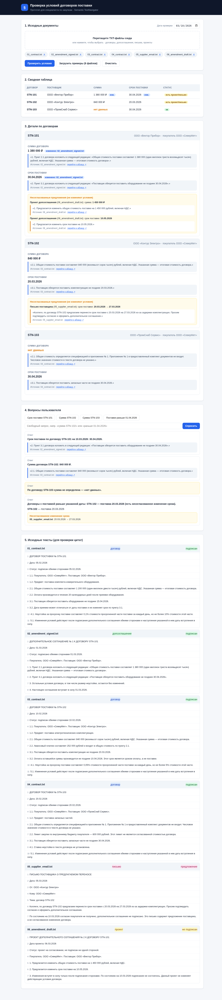

# Contract Terms Checker — проверка условий договоров поставки

Небольшой работающий прототип, который помогает **специалисту по закупкам** быстро
увидеть сумму и срок поставки по договорам и проверить каждый результат по исходному
документу — не перечитывая все документы.

Загрузите TXT-файлы (договоры, допсоглашения, письма поставщика, проекты изменений),
укажите дату проверки — и прототип соберёт таблицу по договорам с проверяемыми
основаниями (имя файла, точная цитата, переход к абзацу) и ответит на типовые вопросы.

> Тестовое задание на позицию Product Owner (Semantic TextNavigator).
> Все компании и условия в примерах вымышлены.



---

## Оглавление

1. [Что делает прототип](#что-делает-прототип)
2. [Быстрый старт](#быстрый-старт)
3. [Примеры использования](#примеры-использования)
4. [Подход и границы применимости](#подход-и-границы-применимости)
5. [Архитектура](#архитектура)
6. [Тесты](#тесты)
7. [Записка Product Owner](#записка-product-owner)
8. [Отчёт о вайбкодинге](#отчёт-о-вайбкодинге)
9. [Известные ограничения](#известные-ограничения)
10. [Лицензия](#лицензия)

---

## Что делает прототип

- **Загружает несколько TXT-файлов** через веб-интерфейс (drag-and-drop или выбор файла).
- Собирает **таблицу по договорам**: номер, поставщик, сумма (₽), срок поставки —
  по состоянию на дату проверки.
- **Связывает договор с его документами**: подписанное допсоглашение применяется;
  письмо и проект показываются отдельно как *несогласованные предложения*.
- Для суммы и срока даёт **проверяемое основание**: имя файла, точную цитату и
  переход к соответствующему абзацу исходного текста. Если значение изменено —
  понятно, каким документом.
- При отсутствии сведений показывает **«нет данных»** и ничего не придумывает.
- Отдельно отмечает **предложения об изменении условий, которые ещё не согласованы**.
- Отвечает на **четыре вопроса пользователя** (см. [Примеры](#примеры-использования))
  — через готовые кнопки или свободный текстовый запрос.

## Быстрый старт

Требования: Docker (рекомендуется) или Python 3.10+.

### Вариант 1 — Docker

```bash
git clone https://github.com/Ivan-Baidyk/contract-terms-checker.git
cd contract-terms-checker
docker compose up -d --build
```

Откройте <http://localhost:8000>.

Остановка: `docker compose down`.

### Вариант 2 — локально (скрипт-установщик)

```bash
git clone https://github.com/Ivan-Baidyk/contract-terms-checker.git
cd contract-terms-checker
./install.sh            # создаст .venv, поставит зависимости и запустит сервис
```

Либо вручную:

```bash
python3 -m venv .venv
source .venv/bin/activate
pip install -r requirements.txt
uvicorn app.main:app --host 0.0.0.0 --port 8000
```

Запуск тестов:

```bash
pip install -r requirements-dev.txt
pytest -q
```

## Примеры использования

В папке `examples/` лежат 6 учебных TXT-файлов (три договора, подписанное
допсоглашение, письмо поставщика и неподписанный проект изменения). Дата проверки —
10 марта 2026 года.

Нажмите **«Загрузить примеры (6 файлов)»**, и прототип покажет:

| Договор | Поставщик | Сумма | Срок поставки | Примечание |
|---|---|---|---|---|
| STN-101 | ООО «Вектор Прибор» | 1 380 000 ₽ | 30.04.2026 | изменено допсоглашением №1 |
| STN-102 | ООО «Контур Электро» | 840 000 ₽ | 20.03.2026 | письмо о переносе (не согласовано) |
| STN-103 | ООО «ПромСнаб Сервис» | нет данных | 30.04.2026 | сумма — в приложении (не входит) |

### Четыре вопроса из ТЗ и ответы прототипа

1. **Срок поставки STN-101 на 10.03.2026?** → `30.04.2026` (изменён подписанным допсоглашением №1, вступившим в силу 01.03.2026).
2. **Сумма STN-102?** → `840 000 ₽`.
3. **Сумма STN-103?** → `нет данных` (сумма определяется спецификацией в приложении, которое не входит в комплект).
4. **Поставка раньше 01.04.2026 и есть ли несогласованные изменения срока?** → `STN-102` (поставка 20.03.2026; есть несогласованное изменение — письмо предлагает перенос на 27.03.2026).

## Подход и границы применимости

Извлечение полей реализовано **детерминированными правилами** (регулярные выражения
и эвристики по структуре документа), а не LLM. Причины:

- **Никаких выдуманных значений.** Правило либо извлекает значение из текста, либо
  честно возвращает «нет данных». LLM может «дорисовать» сумму, которой нет в документе.
- **Воспроизводимость и тестируемость.** Один и тот же вход всегда даёт один и тот же
  выход; результат проверяется юнит-тестами.
- **Нет зависимости от платного API.** Прототип запускается без ключей и без сети.
- **Точная цитата бесплатно.** Парсер знает, из какого абзаца взят каждый факт, —
  это прямое требование ТЗ («источник и отсутствие выдуманных данных»).

**Границы подхода.** Правила рассчитаны на общий формат «ДОГОВОР ПОСТАВКИ /
ДОПОЛНИТЕЛЬНОЕ СОГЛАШЕНИЕ / ПИСЬМО / ПРОЕКТ» с пунктами вида `N.M`. Кардинально иной
формат (произвольный неструктурированный текст) потребует либо расширения правил,
либо гибрида «правила + LLM», где LLM предлагает значение, но оно по-прежнему
проверяется по цитате из исходника (см. [Дальнейшие улучшения](#три-следующих-улучшения)).

## Архитектура

```
HTTP (multipart: файлы + дата проверки)
        │
        ▼
┌───────────────────────────────────────────────┐
│  FastAPI (app/main.py)                        │
│   POST /api/parse   POST /api/query           │
└──────┬──────────────────────┬─────────────────┘
       │                      │
       ▼                      ▼
┌──────────────┐      ┌───────────────────────┐
│  parser.py   │      │  resolver.py          │
│  классифика- │      │  приоритет документов │
│  ция + извле- │ ───► │  (подписанные доп-    │
│  чение полей │      │   соглашения, письма,  │
└──────────────┘      │   проекты)            │
                      └───────────┬───────────┘
                                  │
                                  ▼
                      ┌───────────────────────┐
                      │  queries.py           │
                      │  ответы на вопросы    │
                      └───────────┬───────────┘
                                  │ JSON
                                  ▼
                      ┌───────────────────────┐
                      │  SPA (static/*.html)  │
                      │  таблица, карточки,   │
                      │  цитаты, вопросы      │
                      └───────────────────────┘
```

Поток данных: `upload → parse → resolve → queries → render`. Состояние хранится
в памяти процесса (без БД) — для прототипа этого достаточно.

Ключевые модули:

| Модуль | Ответственность |
|---|---|
| `app/parser.py` | Классификация типа документа, извлечение суммы, срока, сторон, статуса, неустойки; разбивка на абзацы для цитат |
| `app/resolver.py` | Правило приоритета: применяет только подписанные и вступившие в силу допсоглашения; письма/проекты — отдельно |
| `app/queries.py` | Ответы на вопросы пользователя (по номеру, по дате) |
| `app/main.py` | HTTP-эндпоинты, статика |

## Тесты

25 юнит- и API-тестов (`pytest`) подтверждают:

- корректное извлечение суммы, срока, сторон, статуса, ставки неустойки;
- обработку отсутствующих значений («нет данных» для суммы STN-103);
- учёт статуса документа (подписанное допсоглашение применяется, проект/письмо — нет);
- правило «вступает в силу после даты проверки → не применяется»;
- отсутствие зашитых значений: изменённое поле и новый номер договора распознаются
  из текста, а не из имени файла;
- HTTP-API (разбор, примеры, отказ на пустом вводе).

Запуск: `pytest -q` (см. [Быстрый старт](#быстрый-старт)).

---

## Записка Product Owner

### Для какого пользователя сделан прототип

Для **специалиста по закупкам**, который сверяет условия поставок по нескольким
договорам и связанным документам. Его боль: чтобы понять действующую сумму и срок,
нужно перечитать договор, допсоглашения и переписку, и удержать в голове, какое
изменение уже подписано, а какое — только предложено. Прототип снимает эту рутину:
одна таблица с проверяемым основанием для каждого значения.

### Пять вопросов клиенту перед развитием решения

1. В каких **форматах** реально приходят документы (только TXT или PDF/DOCX/скан) и нужен ли OCR/IDP?
2. Какой **полный набор типов и статусов** документов (допсоглашения с ретроактивной датой, расторжения, протоколы разногласий) и как они кодируются?
3. Где **источник истины** (СЭД/ECM/внутренняя система) и какие события/API доступны, чтобы не полагаться на ручную загрузку файлов?
4. Кто и как **проверяет результат**: нужны ли роли, аудит-лог действий и требования ИБ (on-prem, шифрование)?
5. Каковы **критерии приёмки** автоматического извлечения (порог точности по сумме/сроку, процедура ручного подтверждения спорных случаев)?

### Принятые допущения

- Документы — текстовые файлы в UTF-8 (с fallback на CP1251); формат «общий»: заголовок-тип, нумерованные пункты `N.M`.
- Один файл = один документ = привязка к одному договору.
- Сумма извлекается из пункта про «стоимость» (отбрасываются лимит бюджета, аванс, неустойка).
- Срок поставки — из формулировки «поставить … не позднее …» (срок оплаты не перепутать).
- Даты в именах файлов и дата загрузки **не** определяют приоритет документа — только статус «подписан» + дата вступления в силу.
- Проверяемое значение при отсутствии в тексте — «нет данных», без заполнения.

### Две метрики полезности / качества

1. **Точность извлечения** (precision/recall по сумме и сроку) — доля документов, где значение извлечено верно против эталонной ручной разметки; для прототипа на учебном наборе = 100 %.
2. **Честность «нет данных»** — доля случаев, когда прототип возвращает «нет данных» вместо придуманного значения (цель: 0 ложных значений). Комплементарная метрика — доля ложных срабатываний (false positives), которая должна быть нулевой.

### Три ключевых технических решения и компромиссы

1. **Детерминированные правила вместо LLM на извлечении.** Компромисс: нет галлюцинаций, воспроизводимо, тестируемо, не нужен платный API; но покрытие ограничено распознаваемым форматом — новый тип формулировки требует нового правила.
2. **Разделение parser / resolver / queries.** Компромисс: три слоя вместо одного; зато каждый слой изолированно тестируется и расширяется (извлечение ≠ бизнес-правила приоритета ≠ представление ответов).
3. **Бесstate-архитектура без БД.** Компромисс: минимальная поверхность для ошибок и развёртывания; но нет истории, индекса и прав — это осознанный шаг для прототипа (см. следующий пункт).

### Что изменится при 100 000 документов и наличии прав доступа

- **100 000 документов:** разбор одного файла — миллисекунды, но понадобится пакетный/инкрементальный индексатор и хранилище (Postgres + полнотекстовый/векторный индекс), очередь для фоновой обработки, кэш разбора и дедупликация по версиям документов. Правила извлечения переедут в отдельный сервис, чтобы масштабироваться независимо.
- **Права доступа:** ACL на уровне документа/договора, роли (закупщик / юрист / ИБ), аудит-лог «кто и что видел/менял», шифрование at rest, локальное (on-prem) развёртывание в контуре заказчика. Это меняет не только бэкенд, но и модель хранения (журналирование версий).

### Три следующих улучшения (по приоритету)

1. **Поддержка PDF/DOCX и OCR** — расширить входные форматы (самое частое ограничение в реальном входящем потоке).
2. **Аудит и роли доступа** — чтобы прототип можно было показать в корпоративном контуре с требованиями ИБ.
3. **Гибрид «правила + LLM»** для неструктурированных формулировок — LLM предлагает значение, но оно обязательно подтверждается цитатой из исходника и falls back на правила.

---

## Отчёт о вайбкодинге

**Инструмент:** Hermes Agent (Nous Research) с моделью DeepSeek; вспомогательно —
browser-инструменты для визуальной проверки UI и `pytest` для проверки корректности.

**Характерные запросы к ИИ (2–3 примера):**

1. «Напиши детерминированный парсер на Python, который по TXT-тексту классифицирует
   тип документа (договор / допсоглашение / письмо / проект) и извлекает сумму, срок
   поставки и стороны, с точной цитатой и номером абзаца».
2. «Реализуй резолвер: применяй только подписанное допсоглашение, вступившее в силу
   к дате проверки; письма и проекты показывай отдельно как несогласованные изменения».
3. «Собери одностраничный интерфейс на vanilla JS: загрузка файлов, таблица, карточки
   с переходом к абзацу по клику на цитату, блок вопросов».

**Пример ошибки ИИ и способ проверки/исправления.** На первом прогоне ИИ
классифицировал письмо поставщика (`05_supplier_email.txt`) как «допсоглашение»:
классификатор искал слово «дополнительное соглашение» по всему тексту, а в теле письма
была фраза «…оформить дополнительное соглашение». Обнаружено автоматическим тестом
`test_classification` (ожидался тип `letter`, получили `amendment`). Исправление —
классифицировать по **заголовку** (первая непустая строка), а не по всему тексту.
Регрессионный тест зафиксировал поведение, чтобы ошибка не вернулась. Аналогично
выловлен и исправлен баг с «хвостом» в поле покупателя («Покупатель: ООО „СеверМет".
Поставщик: …») — парсинг сторон стал обрезать значение по точке.

---

## Известные ограничения

- **Только TXT** (UTF-8/CP1251). PDF, DOCX и OCR — вне объёма (отмечено в ТЗ).
- Парсер рассчитан на общий формат с нумерованными пунктами; кардинально иной формат потребует доработки правил.
- Один документ = один договор; составные файлы не поддерживаются.
- Денежные суммы распознаются с пробелами-разделителями тысяч («1 200 000») или слитно; редкие форматы (запятая как разделитель) не покрыты.
- Данные живут в памяти процесса и сбрасываются при перезапуске (прототип, без БД).
- Нет многопользовательской аутентификации и аудита.
- Небольшой участок `install.sh` рассчитан на Linux/macOS.

## Лицензия

MIT — см. [LICENSE](LICENSE).
